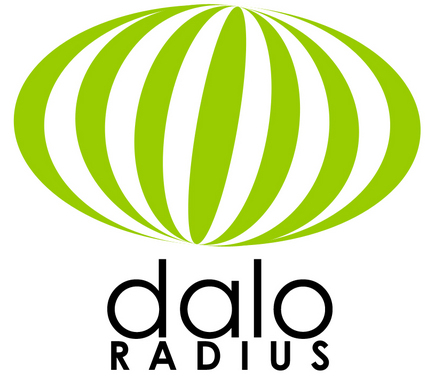

<p align="center">
  
</p>

**daloRADIUS** is an advanced RADIUS web management application for managing hotspots and general-purpose ISP deployments. It features user management, graphical reporting, accounting, a billing engine, and integrates with [OpenStreetMap](https://www.openstreetmap.org/copyright) for geolocation. The system is based on [FreeRADIUS](https://freeradius.org/) with which it shares access to the backend database.

**daloRADIUS** is written using [PHP](https://www.php.net/) and uses native [PDO](https://www.php.net/manual/en/book.pdo.php) for database access. The installation paths target **MariaDB with the PDO MySQL driver (`pdo_mysql`)**; existing `mysql` and `mysqli` configuration values both select that PDO driver. PEAR DB is no longer required. **Other database engines have not been validated end-to-end and are not recommended.** PEAR Mail and Mail_Mime remain separate dependencies for notification delivery.

## Installation
### quick installation
To quickly install a basic standalone AAA infrastructure - based on daloRADIUS - on a [Debian](https://www.debian.org/download) environment, run the following command in a `root` terminal:
```bash
wget -qO - https://raw.githubusercontent.com/lirantal/daloradius/master/setup/install.sh | bash
```
At the end of this procedure, **the installation script will generate random credentials to be used for the operator's first login**.

---
### installation guide
To install daloRADIUS, you can follow the installation guide available in the project's official [wiki](../../wiki/).

Alternatively, you can also find the installation guide in the `doc/install` folder of this repository.

If you encounter any issues during the installation or have any questions, feel free to ask for support in the [Issues](../../issues) section.

## Documentation

The documentation for daloRADIUS is available in Markdown format and can be found in the `doc` folder of this repository.

### Docker

For a complete local stack, copy `.env.example` to `.env`, set the required secrets, and start MariaDB, FreeRADIUS, and the web interfaces with:

```bash
docker compose up -d --build
```

The primary `Dockerfile` can also run the web interfaces alone against externally managed MariaDB and FreeRADIUS services. See the [Docker usage guide](README.docker.md) for environment variables, ports, persistence, upgrades, and both deployment modes.

## Network access and firewall requirements

Allow only the destinations needed by the features you use. Browser traffic and
server traffic originate from different machines; allowing Internet access on
the daloRADIUS server alone does not enable map tiles on an operator workstation.

### Runtime access

| Feature | Connection source | Destination | Protocol / destination port | When needed |
| --- | --- | --- | --- | --- |
| GIS map tiles | Operator browser | `a.tile.openstreetmap.org`, `b.tile.openstreetmap.org`, `c.tile.openstreetmap.org` | HTTPS / TCP 443 | Viewing or editing maps |
| Email notifications | daloRADIUS server | Configured SMTP relay (`CONFIG_MAIL_SMTPADDR`) | TCP / configured `CONFIG_MAIL_SMTPPORT` | Email enabled; commonly 25, 465 or 587, according to relay configuration |
| Operator LDAP / Active Directory login | daloRADIUS server | Configured directory servers | TCP / configured LDAP port; normally 389 for LDAP/StartTLS or 636 for LDAPS | LDAP authentication enabled |
| Database | daloRADIUS server | Configured MariaDB host | TCP / configured database port; normally 3306 | Database on another host; local sockets do not require a network rule |

The current GIS pages use
`https://{s}.tile.openstreetmap.org/{z}/{x}/{y}.png`, with `s` set to `a`, `b` or
`c`. The XYZ values identify the requested map image. Permit these hostnames in
the workstation's firewall or web filtering policy; do not pin the service to
fixed IP addresses. Leaflet, its styles and marker images are served locally by
daloRADIUS: access to `unpkg.com` is no longer required. If tile access is blocked,
the basemap may be blank while local map controls and hotspot markers still load.
Follow the [OpenStreetMap tile usage policy](https://operations.osmfoundation.org/policies/tiles/).
The attribution link to `www.openstreetmap.org` is a user-activated link, not a
separate dependency for loading tiles.

The SMTP relay and directory can be internal services; these are not necessarily
Internet flows. Allow DNS resolution to your approved resolvers wherever a
configured destination uses a hostname. Ordinary help and credits links do not
require a blanket Internet allow rule for normal application operation.

### Installation, updates and optional contributed portals

Installation and updates have separate requirements: the documented installer
uses HTTPS / TCP 443 to `raw.githubusercontent.com` and `github.com`, plus the OS
package repositories configured on the installation host. Docker image builds
and pulls also need the selected registry's authentication and image-download
endpoints. Use the repository/registry provider's current endpoint list rather
than treating these as permanent runtime requirements.

Contributed captive portals under `contrib/chilli` are optional and have their
own network requirements. For the shared PayPal integration, browsers submit to
`www.paypal.com` (or `www.sandbox.paypal.com`) over HTTPS / TCP 443; server-side
IPN verification uses `ipnpb.paypal.com` (or `ipnpb.sandbox.paypal.com`) over HTTPS /
TCP 443. PayPal also needs inbound access to the deployed portal's configured IPN
callback. Other legacy portal templates contain provider-specific external URLs;
review the exact deployed template and the provider's current requirements before
allowing them. These are not requirements for the operators or users portal.

This list covers application dependencies, not all infrastructure rules. Keep
web access to daloRADIUS, NAS-to-FreeRADIUS authentication/accounting, configured
NAS management or disconnect operations, and host-level DNS/NTP/backup traffic
in a separate deployment-specific flow matrix. Do not expose the operators
portal or database to the Internet to enable map tiles.

## Contributors

Special thanks to these wonderful people for their contributions to daloRADIUS...
<p align="center">
  <a href="../../graphs/contributors">
    
  </a>
</p>
... and many more who have contributed to the project over time. Thank you for your valuable contributions!

Would you like to contribute too? Learn how to get started: [How to Contribute](https://github.com/firstcontributions/first-contributions).

# Features

## Management

### User Management

- **List Users**: View a list of all registered users in the system.
- **Create New User**: Easily create new user accounts with required attributes.
<p align="center">
    
</p>

- **Quick Add New User**: Streamlined process for quick user account creation, ideal for POS or HotSpot shops.
- **Edit User**: Modify user account details and attributes as needed.
- **Search User**: Easily find users using various search criteria.
- **Delete User**: Remove user accounts from the system.

### HotSpot Management

- **List HotSpots**: View a list of all configured hotspots.
- **Create New HotSpot**: Effortlessly create new hotspots and configure their settings.
- **Edit HotSpot**: Modify hotspot details and settings as required.
- **Delete HotSpot**: Remove hotspots from the system.

### NAS Management

- **List NAS**: View a list of all Network Access Servers (NAS) registered in the system.
- **Create New NAS**: Add new NAS devices to manage network access.
- **Edit NAS**: Modify NAS details and settings.
- **Delete NAS**: Remove NAS devices from the system.

### Groups Management

- **List, Create New, Edit and Delete User-Groups Mapping**: Manage user-group mapping in the radius database.
- **List, Create New, Edit and Delete Group-Reply and Group-Check Settings**: Configure group-wide attributes in the radius database.

## Accounting

### Users Accounting By

- **Username**: View accounting information for specific users by their username.
- **IP Address**: Monitor accounting details based on the user's IP address.
- **NAS IP Address**: Track accounting data based on the NAS IP address.
- **Date (From/To)**: Get accounting records within a specified date range.
- **Display of All Accounting Records**: Access a comprehensive view of all accounting records in the radius database.
- **Display of Active Accounting Records**: Monitor active accounting sessions using Max-All-Session attribute or Expiration attribute.
- **Open-Session Maintenance**: Preview open accounting records and either close them while retaining usage data or permanently delete selected records. See [Maintaining open accounting sessions](doc/setup/open-session-maintenance.md).
- **Custom Accounting Query**: Perform custom accounting queries to extract specific data.

### HotSpots Accounting

- **Comparison of Accounting for different HotSpots**: Compare accounting data for different hotspots, providing information on hotspot's unique users, total hits, average time, and total time.

### GIS - Geographical Information System

daloRADIUS comes with integrated support for GIS provided by Leaflet and an OpenStreetMap basemap, enabling the visual location of deployed HotSpots across a map. It allows you to see their status and monitor them visually.

- **View Map**: Monitor deployed HotSpots using the GIS map.
- **Edit Map**: Add or delete HotSpots directly on the map, without navigating to the HotSpots Management page.

## Reporting

### Basic Reporting

- **Online Users**: View online users currently connected to the system from all NAS devices at a current point in time.
- **Last Connection Attempts**: View last connection attempts and their status - whether they were rejected or successful.
- **Search Users**: Search for Users - similar to the functionality in User Management page.
- **Top Users**: View a report of the Top Users based on their Bandwidth consumption or Time usage.

### Logs Reporting

- **daloRADIUS Log**: Keep track of all actions performed within the daloRADIUS interface, such as page visits, form actions (e.g., deleting users, creating new hotspots), and queries submission for user accounting.
- **RADIUS Server Log**: Monitor the FreeRADIUS server logfile.
- **System Log**: Monitor the system log, which can include syslog or messages, depending on the configuration.
- **Boot Log**: Monitor the boot/kernel log (dmesg).

### Status Reporting

- **Server Status**: Provides detailed information on the server where daloRADIUS is deployed, including CPU utilization, uptime, memory, disk information, and more.

The former **Services Status** page has been removed. Monitor daloRADIUS, FreeRADIUS, and the database using your preferred external monitoring solution (for example, [Zabbix](https://www.zabbix.com/) or [Prometheus](https://prometheus.io/)), with availability checks and alerting independent of the PHP web interface. Remove any bookmarks to the former page.

## Billing

- **POS (Point of Sales)**
- **Plans**
- **Rates**
- **PayPal Transactions**
- **Billing History**
- **Invoices**
- **Payments**

## Graphs

### Users Graphs

Provides visual graphs and statistical listing per user connection's attributes, including:

- **Logins/Hits**
- **Download**
- **Upload**

### Server-Wide Graphs

Provides visual graphs and statistical listing for the entire server, showing all-time information on:

- **Logins/Hits**
- **Traffic Comparison**

## Configuration

### Global Configuration

- **Database Settings**: Configure database connection information (storage: MySQL, PostgreSQL, and others), credentials (username and password), radius database table names (radcheck, radacct, etc.), and database password encryption type (none, md5, sha1).
- **Language Settings**: daloRADIUS is multi-lingual and currently supports English and Russian language packs.
- **Logging Settings and Debugging**: Enable logging of different actions, queries, and page visits. Also supports debugging of SQL queries executed.
- **Interface Settings**: Support for displaying password text in either clear-text or as asterisks to hide it. Table listing spanning across multiple pages is configurable on the number of rows per page and addition of number links for quick-access to different pages.

### Maintenance

- **Test User Connectivity**: Provides the ability to check if a user's credentials (username and password) are valid by executing a radius query to a radius server (configurable for radius port, shared secret, etc.).
- **Disconnect User**: Supply a username and send a PoD (Packet of Disconnect) or CoA (Change of Authority) packet to the NAS to disconnect the user.

### Operators

daloRADIUS supports Operators for complete management of the entire platform. Different Operators can be added with their contact information and ACLs settings to grant or revoke them permissions to access different pages.

- **List Operators**
- **Create New Operator**
- **Edit Operator**
- **Delete Operator**
- **Two-Factor Authentication**: Operators can enable TOTP-based MFA for their own account. Administrators can reset an operator's MFA from the UI or from the server command line; see [Operator two-factor authentication recovery](doc/setup/operator-mfa.md).

### Database migrations

For new installations, use the schemas found in `contrib/db/mariadb-daloradius*.sql`. If you're upgrading an existing daloRADIUS setup, review `contrib/db/migrations/` and apply the relevant SQL migrations before using any newly introduced features. See the [upgrade notes](../../wiki/daloRADIUS-upgrade-notes-(Debian)) in the wiki for details.

User portal passwords are separate from FreeRADIUS password attributes. Newly created or changed portal credentials are stored using PHP's `password_hash()`; existing installations should follow the [user portal password upgrade guide](doc/setup/user-portal-passwords.md) to migrate legacy plaintext values.


# Credits

 [daloRADIUS](http://www.daloradius.com) makes use of several third-party packages and I would like to thank these
 great tools and their authors for releasing such a good software to the community.
* bootstrap - [https://getbootstrap.com/](https://getbootstrap.com/)
* bootstrap icons - [https://icons.getbootstrap.com/](https://icons.getbootstrap.com/)
* dompdf - [https://github.com/dompdf](https://github.com/dompdf)
* htmlpurifier - [https://github.com/ezyang/htmlpurifier](https://github.com/ezyang/htmlpurifier)
* Chart.js - [https://www.chartjs.org/](https://www.chartjs.org/)
* Leaflet - [https://leafletjs.com/](https://leafletjs.com/)
* phpmailer - [https://github.com/PHPMailer/PHPMailer](https://github.com/PHPMailer/PHPMailer)
* php-svg-qrcode - [https://github.com/philronan/php-svg-qrcode](https://github.com/philronan/php-svg-qrcode)
* totp-php - [https://github.com/remotemerge/totp-php](https://github.com/remotemerge/totp-php)


# Support
Helpful resources to find help and support with daloRADIUS:

* [daloRADIUS Issues](../../issues)

# Copyright
- [Filippo Lauria](https://github.com/filippolauria/), main mainteiner of this repository;
- [Liran Tal](https://github.com/lirantal/), the original creator of daloRADIUS;
- [Miguel García](https://github.com/MiguelVis) and all contributors for their valuable work.

## Contributing

Please consult [CONTRIBUTING](./CONTRIBUTING.md) for guidelines on contributing to this project.
